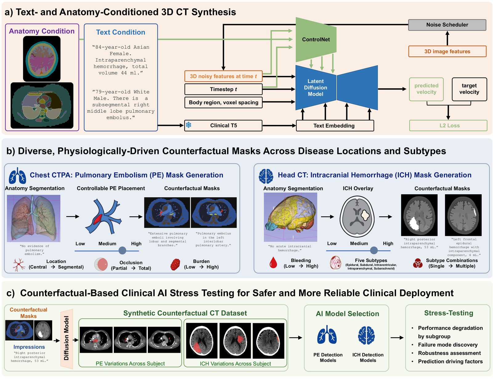
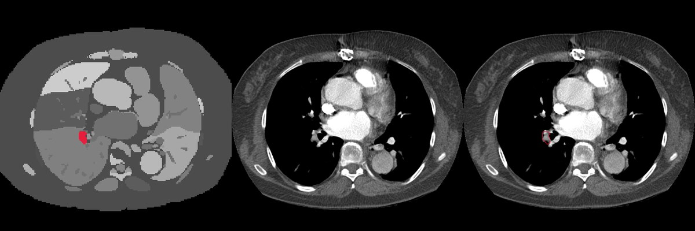
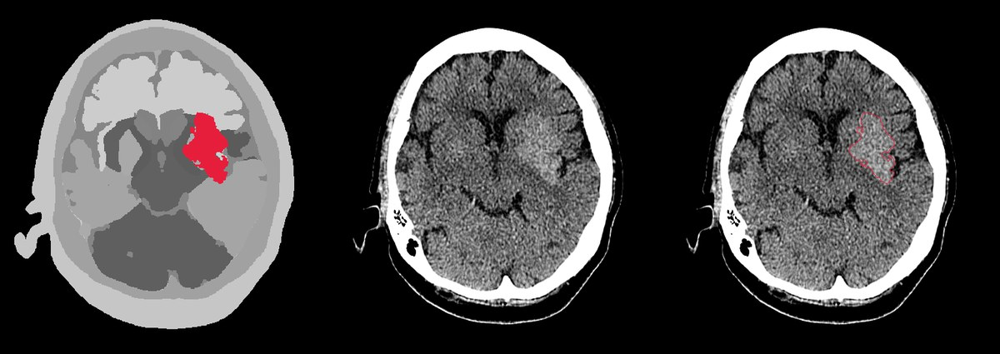
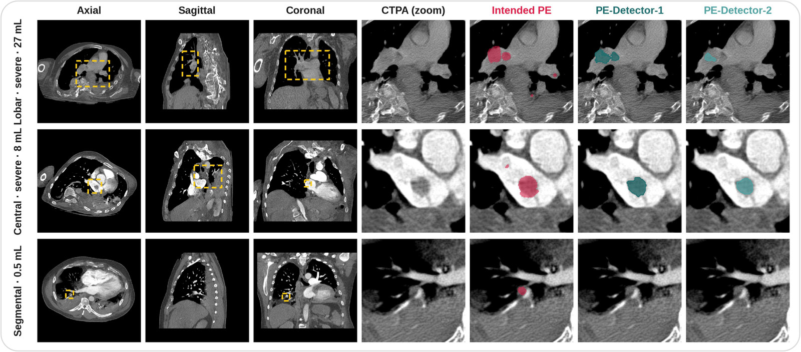

# Stress-testing clinical AI with anatomically constrained counterfactual CT

[Project page](https://magdapaschali.com/counterfactual-evaluation/) | [Interactive demo](https://magdapaschali.com/counterfactual-ct-demo/) | Data and models on HuggingFace: `<HF_URL>` (link to be added)

We generate counterfactual CT scans: synthetic scans of one source patient in which only the
target lesion changes. We change the lesion location, size and type in a controlled way and
measure how detection models respond.



*Overview (Fig. 1 of the paper). (a) A latent diffusion model with a ControlNet generates a CT
from an anatomy mask and a text prompt. (b) Counterfactual masks place a lesion in the anatomy
of a disease-free scan. (c) The generated scans are used to test detection models.*

## Generate scans

Each generator makes a CT from a label map and a text prompt. You need a GPU. Download the
weights once:

| Weights | Source | Put them in |
|---|---|---|
| Our fine-tuned diffusion U-Net and ControlNet, for PE and for ICH | HuggingFace, `<HF_URL>` (link to be added), folder `models/` | `weights/pe/`, `weights/ich/` |
| MAISI autoencoder (VAE), not retrained | [`nvidia/NV-Generate-CT`](https://huggingface.co/nvidia/NV-Generate-CT), file `models/autoencoder_v1.pt` | `weights/models/` |
| ClinicalT5-base text encoder | `luqh/ClinicalT5-base`, converted by the command below | `weights/clinicalt5-pytorch/` |

### Pulmonary embolism (CT pulmonary angiography)

```bash
cd 01_pe_diffusion
pip install -r requirements.txt
export PYTHONPATH=$(pwd):$(pwd)/scripts:$PYTHONPATH
huggingface-cli download nvidia/NV-Generate-CT models/autoencoder_v1.pt --local-dir ../weights
export CF_CLINICALT5=$(pwd)/../weights/clinicalt5-pytorch
python scripts/convert_t5.py                       # once
python scripts/infer_controlnet.py -g 1 \
  -e ../examples/pe/environment.json \
  -t ./configs/config_maisi_controlnet_train.json
```

The example input is [`examples/pe/example_pe_mask.nii.gz`](examples/): a label map made from
open data (TotalSegmentator dataset, CC BY 4.0) with one embolus in the right lower lobe
pulmonary artery, and the prompt "71 year old female. IMPRESSION: 1. Pulmonary embolus in the
right lower lobe pulmonary artery." The run takes about one minute on one NVIDIA L40. It
writes the generated CT (`example_pe_pred_<time>_image.nii.gz`, 512 x 512 x 256 voxels) and
its label map (`..._label.nii.gz`) to `examples/pe/output/`.



*PE example. Left: conditioning mask with the embolus in red. Middle: generated CT. Right:
generated CT with the outline of the embolus.*

More options (your own masks, the released masks, several GPUs, the PE detector on the
output): [`01_pe_diffusion/README.md`](01_pe_diffusion/).

<details><summary>Train</summary>

The PE models were trained on INSPECT, which you can request from its source: [INSPECT dataset
page](https://aimi.stanford.edu/datasets/inspect-Multimodal-Dataset-for-Pulmonary-Embolism-Diagnosis-and-Prognosis). The steps (VAE latents, label maps, U-Net, ControlNet) are in the "Train"
block of [`01_pe_diffusion/README.md`](01_pe_diffusion/). The masks for new counterfactuals
are made in [`03_counterfactual_masks/pe/`](03_counterfactual_masks/pe/).

</details>

### Intracranial hemorrhage (non-contrast head CT)

```bash
cd 02_ich_diffusion
pip install -r requirements.txt
export PYTHONPATH=$(pwd):$(pwd)/scripts:$PYTHONPATH
export CF_CLINICALT5=$(pwd)/../weights/clinicalt5-pytorch    # made by convert_t5.py in the PE block
export CF_CLINICALT5_TOKENIZER=luqh/ClinicalT5-base
python scripts/infer_controlnet_headct_infer_embed_then_decode.py -e <your_environment.json>
```

The input is a head label map with the hemorrhage added and a short prompt, listed in a
datalist; the environment file points to the datalist, the weights and an output folder (format
in [`02_ich_diffusion/README.md`](02_ich_diffusion/)). One scan takes about two minutes on one
NVIDIA L40. A runnable public ICH example will be added.



*ICH, generated from one of the released conditioning masks. Left: conditioning mask with the hemorrhage in red. Middle: generated CT. Right:
generated CT with the outline of the hemorrhage.*

More options: [`02_ich_diffusion/README.md`](02_ich_diffusion/). The source and license of the PE
example are in [`examples/README.md`](examples/).

<details><summary>Train</summary>

The ICH models were trained on internal head CT studies, which are not public. The steps
(segmentation, label maps, VAE latents, U-Net, ControlNet) are in the "Train" block of
[`02_ich_diffusion/README.md`](02_ich_diffusion/). The masks for new counterfactuals are made
in [`03_counterfactual_masks/ich/`](03_counterfactual_masks/ich/).

</details>

## What the paper tests

| Task | Counterfactuals | Source patients | Detectors |
|---|---|---|---|
| Pulmonary embolism | 2,347 | 150 ([INSPECT](https://aimi.stanford.edu/datasets/inspect-Multimodal-Dataset-for-Pulmonary-Embolism-Diagnosis-and-Prognosis)) | PE-Detector-1 ([nnUNet3D-ResEncXL](https://github.com/mazurowski-lab/PulmonaryEmbolismSegmentation)), PE-Detector-2 ([APES](https://github.com/AIinMedicalApplications/APES_ThrombusSegmenter)) |
| Intracranial hemorrhage | 2,601 | 150 (internal head CT cohort) | ICH-Detector-1 ([Viola-UNet](https://github.com/samleoqh/Viola-Unet)), ICH-Detector-2 ([3D ResNet-101 classifier](https://github.com/stanfordaide/ICH_EMM)) |



*Three PE counterfactuals (Fig. 3a). Columns: three views of the generated scan, a zoom on the
embolus, the intended embolus, and the output of each detector. In the bottom row neither
detector marks the embolus.*

Overall detection rates (95% CI): PE-Detector-1 66.5% (64.2 to 68.8), PE-Detector-2 62.3%
(59.3 to 65.3), ICH-Detector-1 59.4% (56.9 to 61.9), ICH-Detector-2 71.8% (67.4 to 76.1).

## Repository map

| Folder | What it does |
|---|---|
| [`01_pe_diffusion/`](01_pe_diffusion/) | PE generator (MAISI ControlNet): training, inference, and the fidelity metrics (FID, CLIPScore). |
| [`02_ich_diffusion/`](02_ich_diffusion/) | ICH generator (MAISI ControlNet with a brain-window intensity transform): training and inference. |
| [`03_counterfactual_masks/`](03_counterfactual_masks/) | Conditioning masks. `pe/`: emboli placed in the pulmonary arterial tree on a grid of 16 configurations per patient, and the scoring of the PE detectors against the intended emboli. `ich/`: donor hemorrhages moved into disease-free head anatomy. |
| [`04_evaluation_and_analysis/`](04_evaluation_and_analysis/) | Detector scoring on the counterfactuals and on external real datasets, and all statistics of the paper. Its README maps each paper result to a script. |
| [`resources/`](resources/) | Small tables that the analysis reads: cohort, detector outputs, radiologist ratings, external validation results. |
| [`examples/`](examples/) | One example input per task for the generators. |
| [`splits/`](splits/) | INSPECT train and test study identifiers used for the PE generator. |

Order of the pipeline: `03` makes the masks, `01` or `02` generates the CTs, `04` scores the
detectors and computes the statistics. Each folder has its own README with the commands.

## Reproduce the paper statistics

This needs a CPU and no download. All statistics run from the tables in `resources/`.

```bash
cd 04_evaluation_and_analysis
pip install -r requirements.txt
python patient_bootstrap/text_numbers.py      # detection rates and radiologist results with 95% CIs
python patient_bootstrap/figure_numbers.py    # values behind Figs. 4, 6b and 7
python analysis/refit_pe_drivers.py           # PE odds ratios (Fig. 5a)
python analysis/run_ich_glmm.py               # ICH odds ratios (Fig. 5b)
python analysis/cohort_descriptives.py        # cohort numbers and Supplementary Table 1
```

Outputs go to `04_evaluation_and_analysis/output/`. The full list of scripts, with the paper
item that each one produces, is in
[`04_evaluation_and_analysis/README.md`](04_evaluation_and_analysis/README.md).

## Data and models (HuggingFace)

The large files are on HuggingFace: `<HF_URL>` (link to be added).

- `dataset/`: the PE and ICH counterfactual CT volumes, their conditioning masks, the PE
  disease-free synthetic scans, and one `properties.csv` per task that describes each
  counterfactual (lesion volume, location, severity, type, detector output).
- `models/`: the fine-tuned diffusion U-Net and ControlNet for PE and for ICH. Both use the
  unchanged MAISI autoencoder, which you download from NVIDIA
  ([`nvidia/NV-Generate-CT`](https://huggingface.co/nvidia/NV-Generate-CT), `models/autoencoder_v1.pt`).

What is not in this release, and where to get it:

- PE training data and source scans: INSPECT, from the [INSPECT dataset page](https://aimi.stanford.edu/datasets/inspect-Multimodal-Dataset-for-Pulmonary-Embolism-Diagnosis-and-Prognosis),
  under its data use agreement.
- ICH training data and source scans: internal head CT studies. They are not public.
- Radiology reports and impressions, the text prompts made from them, and patient demographics.
- The detector models. They are open-weight models from other groups:
  [PE-Detector-1](https://github.com/mazurowski-lab/PulmonaryEmbolismSegmentation), [PE-Detector-2](https://github.com/AIinMedicalApplications/APES_ThrombusSegmenter), [ICH-Detector-1](https://github.com/samleoqh/Viola-Unet), [ICH-Detector-2](https://github.com/stanfordaide/ICH_EMM).
- The raw external datasets (FUMPE, CAD-PE, READ, PhysioNet CT-ICH). They are available from
  their original sources. We release only our detection results on them.

## Requirements

Each component has its own `requirements.txt` (in `03_counterfactual_masks/`, one per
subfolder). The generators (`01`, `02`) need a GPU and the PyTorch and MONAI stack. The mask
pipelines (`03`) and the analysis (`04`) run on a CPU. Paths to data that is not in this
repository are set with environment variables (`CF_DATA`, `CF_RAW`, `CF_OUT` and others).
Each folder README lists the ones it uses. The SLURM launchers (`*.sh`, `*.sbatch`) need the
settings of your own cluster.

## License

The code is released under the Apache License 2.0 (see `LICENSE`). Parts of `01_pe_diffusion/`
and `02_ich_diffusion/` are derived from MONAI MAISI, which is also under Apache 2.0. The data
and our fine-tuned model weights on HuggingFace are released under CC BY-NC 4.0. The pre-trained
MAISI weights that we fine-tuned are licensed by NVIDIA Corporation under the NVIDIA Open Model
License; its conditions also apply to our fine-tuned weights (see the model card).
The example mask in `examples/pe/` is derived from the TotalSegmentator dataset and is under
CC BY 4.0 (see `examples/README.md`).

## Citation

Preliminary entry:

```bibtex
@article{paschali2026counterfactual,
  title  = {Stress-testing clinical {AI} with anatomically constrained counterfactual {CT}},
  author = {Paschali, Magdalini and
            Sun, Susu and
            Moroianu, Stefania and
            Na, Hye Sun and
            Liu, Jiaming and
            Fang, Zhongnan and
            Gonzalez, Camila and
            Durak, Gorkem and
            Taktak, Yavuz B. and
            Ikizgul, Oyku and
            Ji, William and
            Langlotz, Curtis P. and
            Bluethgen, Christian and
            Baumgartner, Christian and
            Bagci, Ulas and
            Larson, David B. and
            Chaudhari, Akshay S.},
  year   = {2026}
}
```
